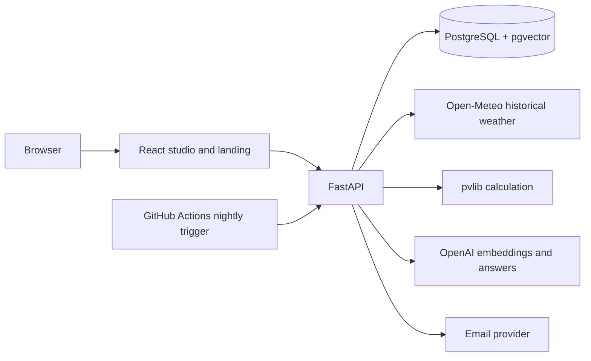

# Solar Studio — engineering case study

## The problem

The original university brief described a solar planning system, but the earlier submission did not show the work at its best. Solar Studio rebuilds that idea as a usable personal showcase: a person can place panel setups on a map, compare estimates from past weather, and understand the assumptions behind each result. The app never presents an estimate as a reading from actual equipment.

## The product journey

A visitor sees a scroll-driven roof and sun, then changes the place, direction, slope, and panel count in a live one-day trial. After signing in, they create a project, pick a place, choose a manufacturer panel, enter roof space, direction, slope, count, and system loss, and see the previous 30 complete days. They can compare a different arrangement, request a report, and read a PDF. Once email delivery is accepted, the project becomes read-only; copying it creates a fresh experiment.

## Key engineering decisions

- **One Python service:** FastAPI owns identity, authorization, weather access, solar calculation, reports, and AI interfaces. React handles interaction and presentation. This gives one source of truth for all estimates, including the landing page example and AI comparisons.
- **PostgreSQL and pgvector:** Relational records keep accounts, projects, products, weather caches, jobs, and results connected. A vector column stores searchable document passages. SQLite supports a light local start; CI applies migrations to PostgreSQL.
- **Calculation before explanation:** pvlib computes the numbers from hourly historical radiation, temperature, wind, panel orientation, and system loss. AI may explain or propose settings, but it never fabricates the electricity figure.
- **Saved report snapshots:** A report freezes the product specification, setup, date range, source, and calculation name. Product catalogue changes cannot alter old reports.
- **Recoverable work:** Report and PDF indexing jobs save status in the database. The protected nightly endpoint catches up on pending work after downtime. Reports use a unique setup/date key; email delivery uses a provider idempotency key.
- **Evidence-based AI:** Private documents are visible only to their owner. Published product documents become available only while the product remains published. Answers cite PDF pages, and invalid citations are rejected.
- **Motion with a purpose:** The landing scene shows why results change across a day. SVG artwork, scroll-linked sun position, and a calculation-backed chart share one story. Touch, keyboard use, and reduced-motion presentation have dedicated behavior.

## Architecture

## Quality evidence

The repository contains Python tests for ownership, account limits, locking, email retry behavior, weather gaps, invitation protection, AI document visibility, PDF indexing recovery, and admin access. The frontend passes TypeScript build and Prettier. Alembic upgrades and reports no schema drift on a local database. The landing, auth, dashboard, planner, map, chart, report failure state, and roof-space validation were inspected in the browser at mobile, tablet, and desktop widths.

The 40-question RAG benchmark is prepared in `eval/`. Live model scores are **not yet claimed**: running it needs an AI key and an admin evaluation account. Docker and cross-browser execution also need an environment with those tools. Public email and deployment need verified sender and hosting credentials.

## What I would measure after launch

- 40-question grounded-answer and unsupported-answer pass rates, with every failure published.
- Estimate and report job time, weather fetch failures, and AI budget usage.
- Landing load time and animation smoothness on a real phone.
- Keyboard and reduced-motion checks in multiple browsers.

## Short demo video script

1. Start at the landing page. Scroll through the roof, sun, and chart; move the pointer gently on desktop. Change the example place and panel direction in the live trial.
2. Open the studio. Create a project and select Chemnitz on the map.
3. Choose a panel, enter usable roof space, and add a setup. Show the 30-day estimate and daily chart.
4. Ask for a west-facing comparison. Show that Python returns both calculations before saving anything.
5. Request a report, show the PDF and delivery status, then show the read-only project and editable copy.
6. Open the document assistant. Ask a question, follow a cited PDF page, then ask an unsupported question.
